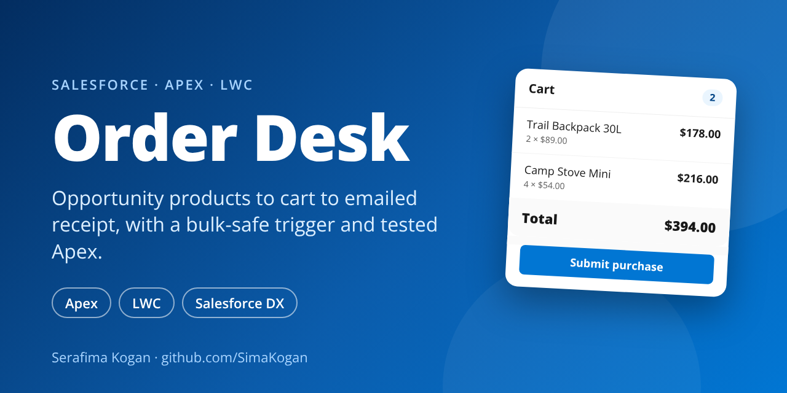
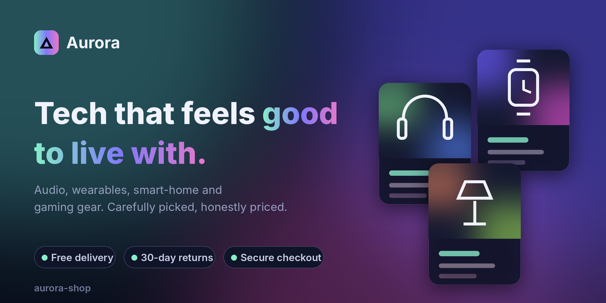
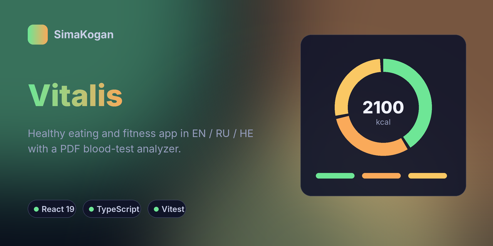
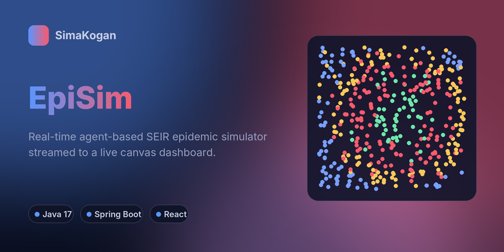
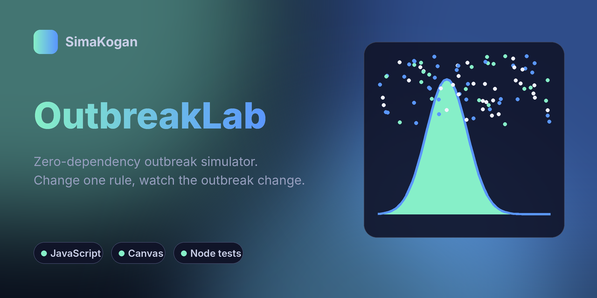
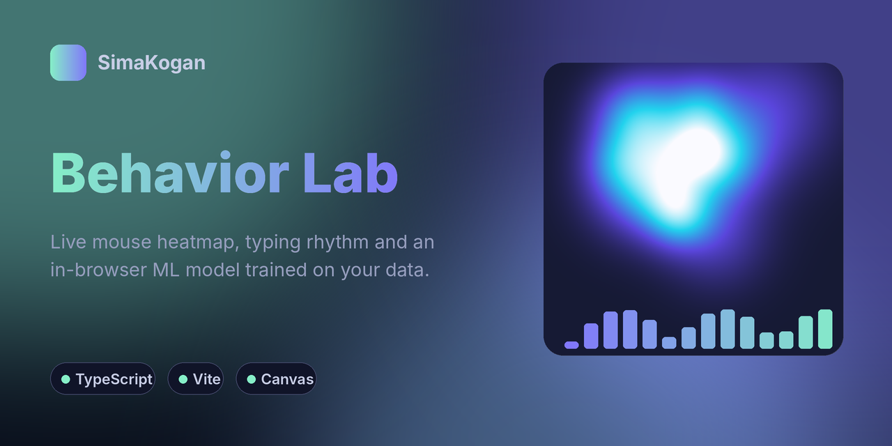
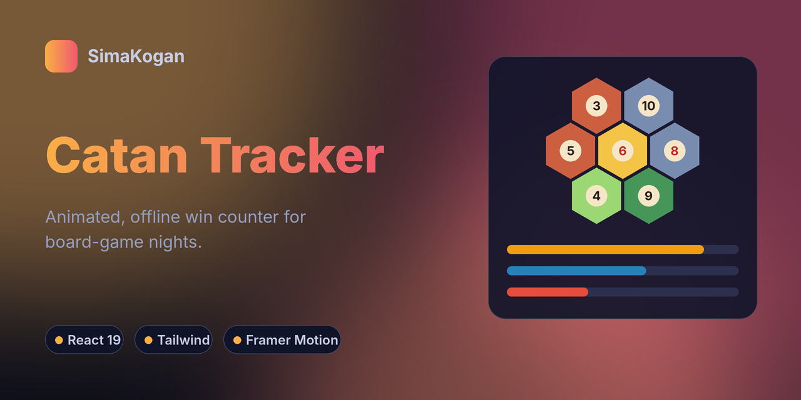
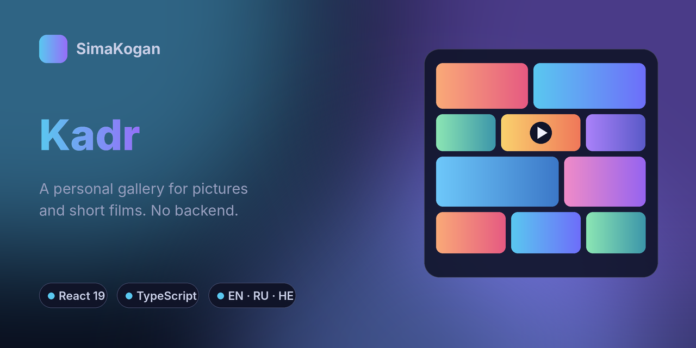
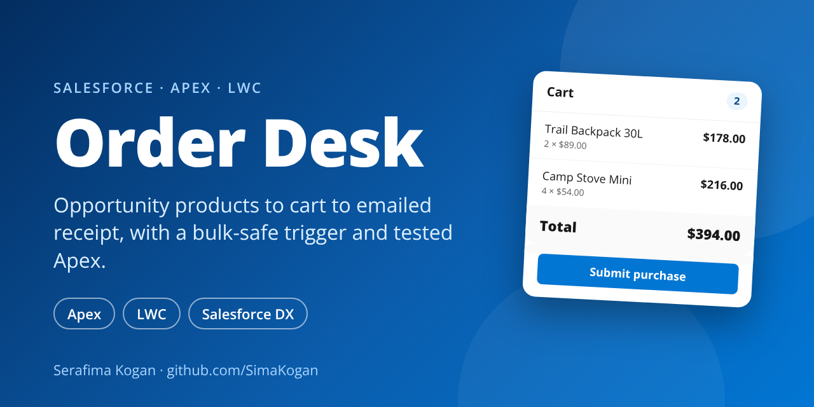
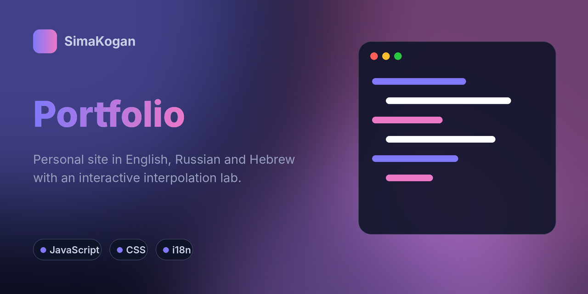

<!-- Template. README.md is generated by: python scripts/build_readme.py -->

 

{{SOCIAL_BADGES}}

---

### ✨ About me

{{ABOUT}}

### 🛠 Tech stack

  

### 📊 GitHub stats

  
  
   
  

### 🐍 Contribution activity

<picture>
  <source media="(prefers-color-scheme: dark)" srcset="https://raw.githubusercontent.com/{{USERNAME}}/{{USERNAME}}/output/github-snake-dark.svg" />
  <source media="(prefers-color-scheme: light)" srcset="https://raw.githubusercontent.com/{{USERNAME}}/{{USERNAME}}/output/github-snake.svg" />
  
</picture>

## Featured projects

### 🤖 [RagBot](https://github.com/SimaKogan/ragbot)

RAG chatbot for Telegram and Slack that answers from your own documents and shows its sources. **Java 17 · Spring Boot 3 · Spring AI · Vertex AI Gemini · pgvector · React · TypeScript · Docker**
Documents (PDF, DOCX, Markdown) are chunked, embedded with Vertex AI and searched in pgvector, and Gemini answers only from what was found, or says it does not know. Every answer carries 👍/👎 buttons in Telegram and Slack, and the ratings are aggregated per source document in a dark-theme React dashboard, so you can see which files make answers worse. Signed Slack webhooks, a token-protected admin API and a Docker Compose setup.

### 🛍️ [Aurora Shop](https://github.com/SimaKogan/aurora-shop) · [Live demo](https://simakogan.github.io/aurora-shop/)

Full-stack online shop with JWT security and an admin panel. **Java · Spring Boot 3 · React · Vite · H2 / PostgreSQL · Docker**
A Spring Boot REST backend with JWT authentication, role-based access (user and admin), products and orders, covered by security and JWT tests, plus a React storefront with dark and light themes. The live demo runs fully offline in the browser, and CI builds and tests every push.

### 🥗 [Vitalis](https://github.com/SimaKogan/vitalis) · [Live demo](https://simakogan.github.io/vitalis/)

Healthy eating and fitness app in English, Russian and Hebrew. **React 19 · TypeScript · Vite · Vitest · pdf.js**
Whole-food recipes with a strict gluten-free and soy-free collection, a calorie and macro calculator, a weekly menu with a shopping list, a blood test analyzer that reads PDFs in the browser, and workouts with an interval timer.

### 🦠 [EpiSim](https://github.com/SimaKogan/epi-sim)

Real-time agent-based SEIR epidemic simulator. **Java 17 · Spring Boot · React · Canvas · SSE**
A Spring Boot engine simulates thousands of individual people, virus mutations, vaccination, lockdowns, masks and testing, and streams every frame to a React canvas dashboard with a live map and charts.

### 🧪 [OutbreakLab](https://github.com/SimaKogan/outbreak-lab) · [Live demo](https://simakogan.github.io/outbreak-lab/)

A zero-dependency outbreak simulator that runs in the browser: change one rule and watch the whole outbreak change. **JavaScript · Canvas · Node tests**

### 🧠 [Behavior Lab](https://github.com/SimaKogan/behavior-lab) · [Live demo](https://simakogan.github.io/behavior-lab/)

Privacy-first behavior analytics that runs entirely in the browser. **TypeScript · Vite · Canvas**
Measures how you move, click and type and shows it as a live mouse heatmap, a typing-rhythm histogram and a mood radar. A small ridge-regression model, written from scratch, learns from your own saved sessions and is validated against a "guess the average" baseline, so it is honest about whether it learned anything. No backend, no key characters recorded, UI in Hebrew, English and Russian.

### 🎲 [Catan Victory Tracker](https://github.com/SimaKogan/catan-tracker) · [Live demo](https://simakogan.github.io/catan-tracker/)

Animated, offline win counter for board-game nights. **React 19 · Vite · Tailwind CSS · Framer Motion**
Live leaderboard with leader highlight, editable player names, an animated SVG hex-map background and smooth micro-interactions. Runs fully in the browser with `localStorage`, no backend.

### 🖼️ [Kadr](https://github.com/SimaKogan/kadr) · [Live demo](https://simakogan.github.io/kadr/)

A personal gallery for pictures and short films. **React 19 · TypeScript · Vite · Vitest**
Justified rows, a full-screen viewer with swipe and keyboard navigation, tag and search filters, a shareable link for every work, dark and light themes, and a trilingual interface (English, Russian, Hebrew with full right-to-left layout). No backend: everything lives in plain files and deploys to GitHub Pages, and an import script resizes photos and reads EXIF dates.

### 🛒 [Order Desk](https://github.com/SimaKogan/order-desk) · [Live demo](https://simakogan.github.io/order-desk/)

Salesforce app that turns opportunity products into a cart and an emailed receipt. **Apex · Lightning Web Components · Salesforce DX · Jest**
A service layer and a bulk-safe trigger guard the purchase life cycle, with Apex tests including a 200-record trigger run and bulk adds. A Lightning Web Components UI handles the cart, and user-mode queries respect permissions and field-level security. Ships with permission sets, a Lightning app and demo data.

### 🌐 [Portfolio](https://github.com/SimaKogan/portfolio) · [Live site](https://simakogan.github.io/portfolio/)

Personal site in English, Russian and Hebrew with an interactive interpolation lab. **JavaScript · CSS · Node tests**

